<picture>
  <source media="(prefers-color-scheme: dark)" srcset="assets/header-dark.svg">
  
</picture>

## Projects

### [Daycare Watch](https://github.com/areebhirani-beep/daycare-watch)

<a href="https://daycare-watch.vercel.app">
  <picture>
    <source media="(prefers-color-scheme: dark)" srcset="https://raw.githubusercontent.com/areebhirani-beep/daycare-watch/main/docs/readme/banner-dark.png">
    
  </picture>
</a>

Texas inspects every licensed daycare and publishes what it finds, but the records sit in a state dataset with more than a hundred thousand rows. Daycare Watch puts them in plain English for parents and sends an alert when the state posts something new about a daycare they are watching. Our team of four built it for the 2026 Congressional App Challenge.

| 14,310 daycares | 118,294 findings | 545 tests | updated daily |
|:-:|:-:|:-:|:-:|

[Try it](https://daycare-watch.vercel.app) · [Demo video](https://youtu.be/UcrsTslTqGI) · Expo / React Native, Python, Postgres + PostGIS, Supabase

### Switchboard

<picture>
  <source media="(prefers-color-scheme: dark)" srcset="assets/switchboard-dark.svg">
  
</picture>

The harness I built Daycare Watch with. It runs a team of coding agents as separate terminals on one repo, each with its own role and folders, talking over a shared message bus. A hook puts new messages straight into each running session, so they answer each other mid-task, and only the integrator touches git. Five terminals passed 1,570 messages over about 48 hours to build the app. The messages above are real ones from that run.

## Experience

| | | |
|---|---|---|
| **Locket** | Product & Growth Intern, the first high school intern they hired. User research on retention, and 3 features shipped in the live app | May to Aug 2026 |
| **A-Game Equity Partners** | Private Equity Intern. Sourced 20+ acquisition leads in trucking and freight | Jun to Aug 2026 |
| **Amboras** (YC) | Contract content creator. 500,000+ views on short-form video | 2026 |

## Leadership

| | | |
|---|---|---|
| **Tuppi** | Co-founder and CEO of a four-person team building NFC food-container tags and an app that flags leftovers before they expire | Aug 2026 to now |
| **Impact Math** | Founder and president. 30+ members and 200+ math kits for under-resourced schools | |
| **Eagle Scout** | Led 200+ scouts on multi-day trips as a junior leader | 2018 to 2024 |

## Other things

**Hackathons:** 1st of ~1,050 teams at Youth Code x AI · 1st of ~150 at InsForge · 1st of ~100 at AICOO, plus Best Team Collaboration · top 4 of ~300 at Steminate Hacks

**[Lantern](https://github.com/areebhirani-beep/lantern):** a course builder for endangered languages. It turns the phrases a community still remembers into flashcards and lessons, and it throws out any word that isn't in those phrases, so it never makes one up.

<picture>
  <source media="(prefers-color-scheme: dark)" srcset="https://raw.githubusercontent.com/areebhirani-beep/areebhirani-beep/output/snake-dark.svg">
  
</picture>

areeb.hirani@gmail.com · [LinkedIn](https://www.linkedin.com/in/areeb-hirani-2a19a337a/)
